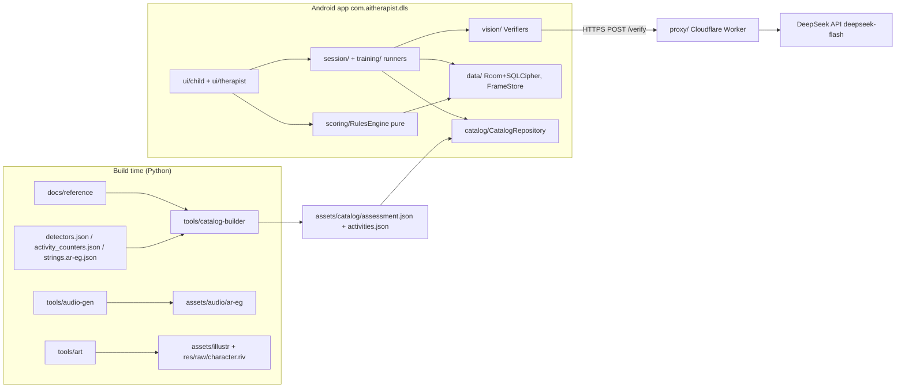
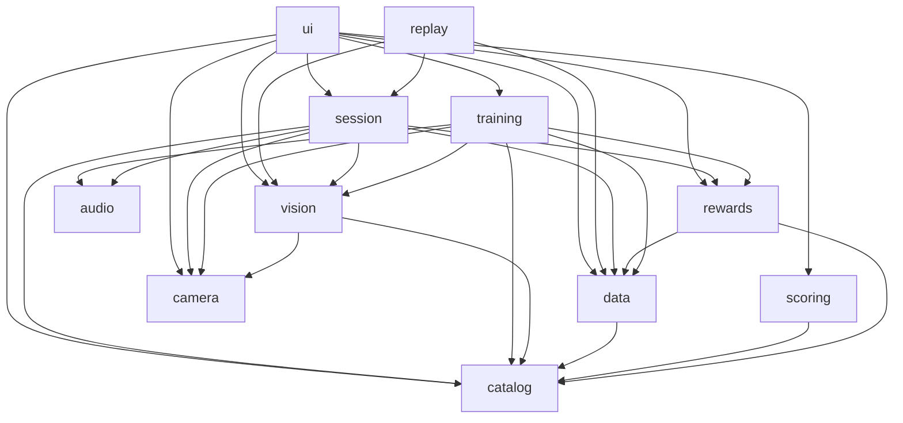
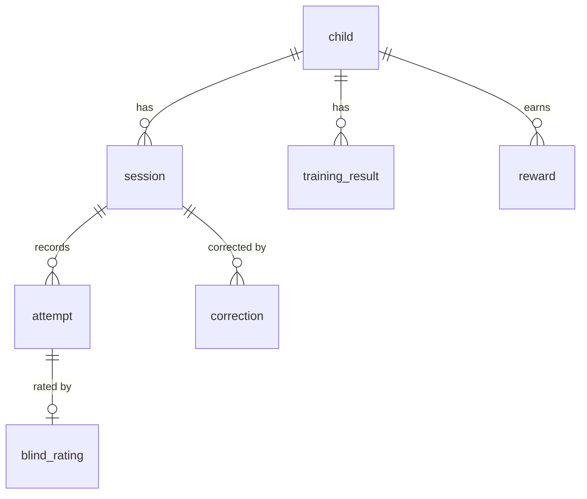
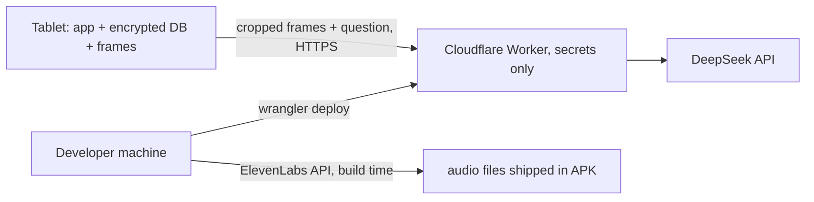

# Architecture Spine: Daily Living Skills App

## Design Paradigm

**Functional core, imperative shell**, in one Android app module, fed by **content compiled at build time** and persisting **facts only**.

- **Core (pure Kotlin, no `android.*` imports):** `scoring/` (RulesEngine), `rewards/RewardRules`, `vision/Geometry`, `vision` check evaluation, `training/RepCounter`, `catalog/CatalogModels`. These are deterministic functions of their inputs and are tested on the JVM.
- **Shell (Android, I/O):** `camera/`, `vision/Landmarkers`, `vision/CloudVerifier`, `session/` runners, `audio/`, `data/`, `replay/`, `ui/`.
- **Content pipeline:** `docs/reference/*.md` + hand-written inputs → `tools/catalog-builder` → `assets/catalog/*.json`. The app never hard-codes a step, tag, rule threshold or activity.
- **Facts vs results:** the database holds what happened (attempts, verdicts, frames, corrections, blind ratings, training results, rewards). Levels, averages, plan levels, strengths and needs, and activity lists are always recomputed by `RulesEngine`.



## Invariants & Rules



Arrows mean "may depend on". Nothing depends on `ui`. `scoring`, `rewards` and `catalog` models depend on nothing Android-specific.

### AD-1: Content is data, compiled once [ADOPTED]

- **Binds:** FR-7, FR-8, FR-9, FR-22, FR-32, FR-34; `tools/catalog-builder`, `catalog/`
- **Prevents:** steps, tags, thresholds or activities drifting between Kotlin code and the source documents; content added that is not in `docs/reference/`.
- **Rule:** `assessment.json` and `activities.json` are the only content contract between `tools/` and `android/`. They are generated, never hand-edited. Build order: `tools/audio-gen`, then `tools/art/export_illustrations.py`, then `tools/catalog-builder`. Kotlin code may not contain a step ID, activity ID, threshold or question literal outside tests. The builder fails the build on: an unknown domain tag, a duplicate ID, a step without Arabic text, audio file (normal and slow) or illustration, an activity without Arabic text or illustration (activity audio is optional, PRD FR-7; training plays it when present), or counts other than 147 steps (42/38/27/40) and 148 activities (48/50/50). Clinical content comes only from `docs/reference/`; `detectors.json` and `activity_counters.json` hold detection settings, never clinical content.

### AD-2: Permanent IDs and version stamps [ADOPTED]

- **Binds:** catalogue, database, proxy, CSV export, eval
- **Prevents:** two parts identifying the same step/activity/clip differently; results that cannot be traced to the content, rules, model and prompt that produced them.
- **Rule:** Step ID `<area>.<task>.<NN>` (areas `dress|eat|drink|hygiene`; tasks as listed in Conventions; `NN` two digits, source step number). Activity ID `<plan>.<domain>.<NN>` (plan `mild|moderate|severe`, domain `rom|coord|hand|midline|planning`). IDs never change once released. `catalogVersion` = first 12 lowercase hex chars of SHA-256 over `assessment.json` bytes followed by `activities.json` bytes; it is written to a separate `assets/catalog/version.json` so it never hashes itself. `RULES_VERSION` is a string constant in `RulesEngine`, bumped on any change to its output. `promptVersion` is owned by the proxy (`proxy/src/prompt.ts`) and returned in each response. Every `session` row stores `catalogVersion` and `rulesVersion`; every cloud `attempt` stores `modelId` (as returned by DeepSeek) and `promptVersion`. Session stamps record provenance only: what was used at run time; results shown are always recomputed with the installed catalogue and rules (AD-5), and replay re-scores under the new versions.

### AD-3: One Verifier contract; doubt is never failure [ADOPTED]

- **Binds:** FR-14, FR-18, FR-19, FR-20, FR-46; `vision/`, `replay/`
- **Prevents:** a verifier throwing, timing out silently, or mapping an error to `not_done` and lowering a level.
- **Rule:** Every verifier implements `suspend fun verify(step: Step, frames: List<Frame>, landmarks: List<LandmarkFrame>, ctx: VerifyContext): Verdict` (`VerifyContext` carries the setup zones as normalised, un-mirrored rectangles; a missing zone gives `CANNOT_TELL` reason `no_zone`) where `Verdict(outcome: Outcome /* DONE | NOT_DONE | CANNOT_TELL */, reason: String, modelId: String?, promptVersion: String?, latencyMs: Long)`. A verifier never throws to the runner: every exception, timeout (8 s for cloud), non-200 status, refusal or schema mismatch returns `CANNOT_TELL` with a machine reason (Conventions). `NOT_DONE` may be returned only from a completed evaluation of the step's check or a model answer of `not_done`. `VisibilityGate` runs first for every `pose`/`hand`/`cloud` step; failure returns `CANNOT_TELL` reason `out_of_frame`. Steps with `method: none` are not verified and are recorded with verifier `none`, outcome `cannot_tell`, reason `not_judgeable`, giving "not scored"; metrics exclude verifier `none` from the "cannot tell" rate. Each step's `Detector.landmarkers` (`pose`, `hand` or both; derived by the builder from the check, both for `cloud`) decides which landmarkers run; each frame is paired with the landmark result nearest in timestamp within 100 ms, else that frame counts as not visible. Kotlin enums serialise to lower_snake via `@SerialName` and the Room type converter (`done`, `not_done`, `cannot_tell`).

### AD-4: Check is a closed sealed type keyed by JSON `type` [ADOPTED]

- **Binds:** `detectors.json`, `activity_counters.json`, `catalog/CatalogModels.kt`, `vision/PoseVerifier`, `vision/HandVerifier`, `training/RepCounter`
- **Prevents:** builder and app disagreeing on check fields; a new check silently ignored.
- **Rule:** `Check` is a Kotlin `sealed class` deserialised by kotlinx-serialization with class discriminator `type`. Allowed types and fields are exactly the design's Check types table: `angleAbove`, `angleBelow`, `pointAbove`, `distanceBelow`, `distanceAbove`, `inZone`, `handsRubbing`, `question`. Landmark references are encoded as `{"lm": "LEFT_WRIST"}` or `{"mid": ["LEFT_HIP", "RIGHT_HIP"]}`; a side-less name (`WRIST`) combined with `side` resolves to LEFT_/RIGHT_. Training criteria are a separate sealed type `Criterion` keyed by `kind` (`reps|hold`) holding a `Check` plus `target`, `perSide`, `low`, `high`; for counting, `low`/`high` are the hysteresis thresholds and override the check's `deg`. A JSON Schema for `Check` and `Criterion` lives in `tools/catalog-builder/schema/` and is the contract. An unknown `type` the catalogue build (Python) and catalogue load (Kotlin). Landmark names are MediaPipe names after un-mirroring; `side` is `left|right|either`; distances are ratios of shoulder width in the same frame; `holdSec` must hold continuously within the window. Adding a type means changing the builder schema, `CatalogModels`, the evaluator and its tests in one change.

### AD-5: RulesEngine is the single, pure source of results [ADOPTED]

- **Binds:** FR-23, FR-24, FR-25, FR-27, FR-28, FR-31, FR-32; `scoring/`, every screen showing a level
- **Prevents:** a screen computing its own level or average; stored results going stale after a correction.
- **Rule:** `scoring/RulesEngine.kt` has no Android, Room or coroutine imports and exposes `stepLevel`, `domainAverages`, `planLevel`, `activitiesFor`, `strengthsAndNeeds`, `compare`. Inputs are plain data (attempt facts, correction, catalogue tags/activities). No level, average, plan level or activity list is ever written to the database or cached past the lifetime of a screen state. Implements `scoring-rules.md` exactly: Visual-motor coordination maps to Motor coordination and a step counts once per domain; boundaries 3, 2.5, 1.5 per Rule 2; a domain with no scored steps returns no average; the latest correction wins over the automatic level. Session selection: a report or plan is computed from one finished (`done`) assessment session; the child-level plan uses the latest finished assessment session per task; replay, running, paused and abandoned sessions never feed reports or plans; `compare` takes two finished assessment sessions with the same `taskId`.

### AD-6: Attempt facts and the step-level derivation

- **Binds:** `session/AssessmentRunner`, `data/attempt`, `RulesEngine.stepLevel`, CSV export, eval
- **Prevents:** the runner and the rules engine counting attempts differently (for example after a "cannot tell" repeat or a Help press).
- **Rule:** Each closed attempt window writes exactly one `attempt` row. A repeat after `cannot_tell` writes a new row with the same `number`. `stepLevel` takes, per step, the ordered rows: first `done` row → 3 if its `number` = 1 and its `promptLevel` = 1, else 2; three `not_done` attempt numbers → 1; two consecutive `cannot_tell` rows on one number, or verifier `none` → not scored. Help keeps the attempt `number`, raises `promptLevel` (capped at 3), sets `helpPressed`, replays the new prompt and restarts the window; it never writes a row by itself; Repeat changes neither. In replay, `number` and `promptLevel` are taken from the clip file name, and `attempt.clipFile` (nullable) stores the clip name. The runner advances by calling `stepLevel` on the facts it just saved, not by its own counting.

### AD-7: Proxy contract is fixed; the proxy is stateless [ADOPTED]

- **Binds:** FR-19, FR-20, FR-42; `vision/CloudVerifier.kt`, `proxy/src/`
- **Prevents:** app and Worker drifting on payload shape, limits or error mapping; data being stored outside the tablet.
- **Rule:** `POST /verify`, header `Authorization: Bearer <shared secret>`, body `multipart/form-data` with text fields `requestId` (uuid), `stepId`, `question` and up to 3 binary JPEG file parts named `image` (cropped around hands/object, longest side ≤ 512 px, quality 80; 512 matches DeepSeek's low-detail size and keeps the call inside the 7.5 s proxy timeout — 768 px crops measured 5.8 s and >7.5 s on 2026-11-12); body ≤ 3 MB. The Worker converts each image to a base64 data URL only for the DeepSeek call (inline images keep the proxy stateless; DeepSeek's Files API is not used because it stores files upstream). 200 → `{verdict: "done"|"not_done"|"cannot_tell", reason, modelId, promptVersion}`; 401 wrong secret; 413 too many images or too large; 502 upstream or invalid model output. The Worker calls DeepSeek through the `openai` SDK with `baseURL` set to DeepSeek, model from `MODEL_ID` (default `deepseek-flash`), JSON output mode, then validates the answer against the verdict schema; a refusal or invalid/unparseable model output returns 200 with `verdict: "cannot_tell"`, `reason: "invalid_model_output"`; 502 only when the DeepSeek call itself fails (HTTP or network error); never `not_done`. The Worker has no storage bindings (no KV, D1, R2, logs of bodies). The request never contains a child name, code, profile field or session ID. The app maps every non-200, network error and 8 s timeout to `cannot_tell` with reason `http_<status>`, `network` or `timeout`. A contract change bumps `promptVersion` and updates `proxy/test` and the app's MockWebServer test together.

### AD-8: Data stays on the tablet, encrypted, versioned schema [ADOPTED]

- **Binds:** FR-41 to FR-45; `data/`
- **Prevents:** plaintext child data, unencrypted frames, backup leaks, or schema changes that break existing sessions.
- **Rule:** Room over SQLCipher (`sqlcipher-android` `SupportOpenHelperFactory`). Passphrase: 32 random bytes from first run, encrypted with Keystore AES-256-GCM key `dls_master` (non-exportable), stored in app-private DataStore with the PIN hash (PBKDF2 + salt), proxy URL, encrypted shared secret and the setup zones (`data/SecureSettings`). Frames are buffered in memory and written only when their attempt row is saved, so an interrupted attempt leaves nothing to delete. Frames are written only by `data/FrameStore` as `IV(12 bytes) || AES-GCM(JPEG)` at `files/frames/<sessionId>/<attemptId>-<n>.bin`; `attempt.framePaths` stores these relative paths. Tables are those in the design's Data model (`child`, `session`, `attempt`, `correction`, `blind_rating`, `training_result`, `reward`) plus nullable `attempt.clipFile`; replay sessions belong to one reserved hidden evaluation child (flag `child.isEval`) that earns no rewards; all child-owned rows cascade on child delete and `FrameStore` deletes the child's frame folders in the same operation. Room `exportSchema = true` with schemas committed under `android/app/schemas/`; database version starts at 1 and every change ships an explicit `Migration` plus a migration test; destructive migration is forbidden. `allowBackup="false"`. Only `data/` touches the DAOs; other packages use repository functions.

### AD-9: Facts tables have one writer each

- **Binds:** `session/`, `training/`, `ui/therapist/`, `rewards/`
- **Prevents:** two features updating the same table with different semantics (for example blind ratings changing levels).
- **Rule:** `session` and `attempt`: written only by `AssessmentRunner` (assessment) and `ReplaySource` through the runner (replay); `session.stepIndex/attemptNumber/promptLevel` saved on every transition. `correction`: only the therapist Session detail screen, upsert on (`sessionId`, `stepId`), `level` null meaning "not scored"; the same screen can delete the row to return to the automatic level. `session.state`: only `AssessmentRunner`; at most one `running` or `paused` session per child, and starting a new assessment sets any other to `abandoned`. `blind_rating`: only Blind review; never read by `RulesEngine`. `training_result`: only `TrainingRunner`. `reward`: only `rewards/RewardRecorder`, called by `AssessmentRunner` after a step's facts are saved and by `TrainingRunner` after a training result is saved, using pure `RewardRules`; stickers are computed from finished assessment sessions, not stored as the source of truth; rewards never feed scoring. `child`: only therapist profile screens.

### AD-10: Runner is an explicit state machine with persisted resume point [ADOPTED]

- **Binds:** FR-10 to FR-17, FR-46; `session/`
- **Prevents:** UI-driven step logic; lost progress on process death; replay and live scoring diverging.
- **Rule:** `AssessmentRunner` exposes `StateFlow<RunnerState>` and accepts events (`AudioEnded`, `Done`, `Help`, `Repeat`, `Pause`, `Resume`, `WindowTimeout`, `VerdictReady`). States SHOW → LISTEN → ATTEMPT → JUDGE as in the design. Window close rules and the movement definition are pure functions in `session/AttemptWindow` driven by an injected clock. Every transition is saved before the next state is emitted. Resume restarts the saved attempt and deletes the interrupted attempt's frames. Replay feeds clips through the same runner with MediaPipe VIDEO mode, one clip = one attempt, Done implied at clip end. A Bluetooth key press maps to the `Done` event.

### AD-11: Child-facing effects follow sensory limits

- **Binds:** FR-37 to FR-40, NFR-6; `ui/child/`, `rewards/`
- **Prevents:** effects playing over instructions, unsafe flashing, or rewards depending on level.
- **Rule:** All effects go through one `RewardEffects` entry point that takes the child's `effectLevel` (`full|calm|off`). No effect starts while instruction audio plays; no flash exceeds 3 per second. Stars and stickers are computed by `RewardRules` from saved facts only. Character animation is driven only through the `character.riv` state machine inputs `idle, talk, point, celebrate, celebrateSmall, celebrateBig, encourage`.

### AD-12: Testing and verification gates

- **Binds:** all units; NFR-7
- **Prevents:** untested core logic and drift between the three code bases.
- **Rule:** Pure core is tested on the JVM (`android/app/src/test`); Keystore, SQLCipher and migrations are instrumented tests (`androidTest`). `CloudVerifier` mapping (200, 401, 413, 502, timeout) uses OkHttp MockWebServer; proxy tests mock the `openai` SDK with Vitest. Kover enforces ≥90% line coverage on `RulesEngine`, `Geometry`, `RepCounter`. Catalogue builder tests assert all counts and parsing rules. Each `Check` subtype has a test on synthetic landmarks. The package dependency diagram is enforced by a Konsist architecture test in `android/app/src/test`. A change is done only when every command in Build and verification passes.

### AD-13: UI layer — one state pattern, library components first [ADOPTED]

- **Binds:** all screens in `ui.child`, `ui.therapist`; FR-1 to FR-48 screens; UX DESIGN.md and EXPERIENCE.md State Patterns
- **Prevents:** screens that each invent loading, empty and error handling; hand-built widgets where a maintained component exists; therapist screens that break on a tablet layout.
- **Rule:**
  - **State:** every screen has one `ViewModel` exposing `StateFlow<XxxUiState>` built with `stateIn(viewModelScope, SharingStarted.WhileSubscribed(5_000), Loading)`. `XxxUiState` is a sealed interface with `Loading`, `Empty` (where the screen can be empty), `Content(...)` and `Error(reason)`. Screens collect with `collectAsStateWithLifecycle()` and are stateless composables `XxxScreen(state, onEvent)` with a `@Preview` for each state. One-off events (navigate, toast) are a `Channel` exposed as `Flow`, never state flags. Writes go through a use-case or repository call in `viewModelScope`; the UI never touches DAOs (AD-9).
  - **Loading:** therapist lists, cards and charts show a **skeleton** of the final layout (shimmer from `compose-shimmer`, one synchronized shimmer per screen) when loading takes over 150 ms; no full-screen spinners. Buttons that start work show an inline progress indicator and are disabled until the result. Child mode never shows skeletons, spinners or progress text: loading uses the character `idle` pose and soft dots (EXPERIENCE.md "Judging"). Content swaps use `AnimatedContent`/`Crossfade` (≤300 ms; none in child mode while audio plays, AD-11).
  - **Empty and error:** one shared `EmptyState(icon, message, primaryAction)` and `ErrorState(message, retry)` in `ui/components`; errors are never shown in child mode (AD-3, EXPERIENCE.md).
  - **Navigation:** Navigation 3 (`androidx.navigation3`) with the back stack as state and typed `@Serializable` keys. Therapist mode uses Material 3 adaptive (`NavigationSuiteScaffold` as the rail, `ListDetailPaneScaffold` via `adaptive-navigation3` scene strategy for child list → profile and session → step detail). Child mode is a single full-screen destination driven by `RunnerState` (AD-10), not by navigation.
  - **DI:** Hilt with KSP; `@HiltViewModel` for every ViewModel; pure core classes (`scoring`, `RulesEngine`, `Check`) have plain constructors and no Hilt annotations, so JVM tests build them directly.
  - **Components:** use Material 3 components (buttons, chips, cards, `ModalBottomSheet`, dialogs, `SegmentedButton`, search bar; no pull-to-refresh, since data is local) themed with DESIGN.md tokens in `ui/theme`; Vico for charts; Coil 3 for evidence-frame thumbnails from local files; Rive for the character; Konfetti for particles. A custom component is written only when no library component fits (Done area, visual schedule, level chip, star bar, evidence strip), and lives in `ui/components` with previews.
  - **Text and layout:** all strings in `res/values-ar/strings.xml` (child step text comes from the catalogue, AD-1); RTL-safe modifiers (`start/end`, never `left/right`); target width class Expanded (11-inch landscape, 1280×800 dp) with Medium as the minimum supported.

## Consistency Conventions

| Concern | Convention |
| --- | --- |
| Kotlin packages | `com.aitherapist.dls.{catalog,data,camera,vision,session,scoring,training,rewards,audio,replay,ui.child,ui.therapist,ui.components,ui.theme}` |
| Task IDs | `jacket.on, jacket.off, tshirt.on, shirt.on, trousers.on, socks.on, shoes.on, sandwich, spoon, fork, cup, bottle, straw, handwash, teeth` |
| JSON fields | camelCase in catalogue JSON, proxy API and Kotlin; database columns camelCase as in the design's Data model; enum values lower_snake (`not_done`, `cannot_tell`) |
| IDs and time | Row IDs are UUID v4 text; timestamps epoch milliseconds (UTC) |
| Asset paths | `assets/audio/ar-eg/<id>.mp3` and `<id>.slow.mp3`; `assets/illustr/<id>.webp`; `res/raw/character.riv` |
| Verdict reasons | `out_of_frame`, `no_zone`, `not_judgeable`, `timeout`, `network`, `http_<status>` (for example `http_401`), `invalid_model_output`, or the model's short reason text |
| Errors | Shell code catches at the unit boundary and converts to a `Verdict` or a UI error state; core code returns values, never throws for expected cases |
| Secrets | DeepSeek key only as Worker secret `DEEPSEEK_API_KEY`; `SHARED_SECRET` as Worker secret and in encrypted DataStore; `ELEVENLABS_API_KEY` env var only; none committed |
| Logging | No child name, code, frame or request body in Logcat or Worker logs |
| Locale | Child and therapist UI `ar-EG`, right-to-left, landscape; source code, docs and IDs in English |
| Replay clips | `<stepId>__<attemptNumber>__<outcome>__<volunteer>.mp4`, joined to `eval/clips.csv` by file name |
| Export | `results.csv` columns exactly as the design's Results export; never names |

## Stack

| Name | Version |
| --- | --- |
| Android minSdk / app package | API 30 / `com.aitherapist.dls` |
| Kotlin, Jetpack Compose (BOM), CameraX, Room + KSP, kotlinx-serialization, OkHttp | latest stable at M1, pinned in `android/gradle/libs.versions.toml` |
| MediaPipe Tasks Vision (Pose, Hand) | latest stable (1.x; 1.2.3 on 2026-11-12) |
| SQLCipher for Android (`net.zetetic:sqlcipher-android`) | 4.x (4.18 or later), pinned at M1 |
| Vico (3.x), Rive Android runtime (11.x), Konfetti Compose (2.x) | latest stable at M1, pinned in version catalogue |
| Compose Material 3 (stable line; 1.4.x today, 1.5 "Expressive" once stable), Material 3 adaptive + `adaptive-navigation-suite` + `adaptive-navigation3` | latest stable at M1, from the Compose BOM where covered |
| Navigation 3 (`androidx.navigation3`, 1.2.x stable), Lifecycle ViewModel Compose + `lifecycle-runtime-compose` | latest stable at M1 |
| Hilt + `hilt-navigation-compose` (KSP) | latest stable at M1 |
| Coil 3 (`coil-compose`), `com.valentinilk.shimmer:compose-shimmer` (Apache-2.0) | latest stable at M1 |
| Proxy: Cloudflare Workers, TypeScript, `openai` npm SDK, wrangler, vitest | latest stable at M1, pinned in `proxy/package-lock.json` |
| Online model | DeepSeek `deepseek-flash` (V4.1 Flash, multimodal) via `MODEL_ID` |
| Python tools | 3.11; pytest, ruff; `elevenlabs` SDK |

## Structural Seed

```text
android/                 one Gradle app module; schemas/ for Room schema export
proxy/                   Cloudflare Worker: src/index.ts, src/prompt.ts, test/
tools/catalog-builder/   build_catalog.py, detectors.json, activity_counters.json, strings.ar-eg.json, tests
tools/audio-gen/         generate_audio.py, config.json, manifest.json
tools/art/               export_illustrations.py
art/                     character sheet, character.riv, steps/, stickers/, sfx/
eval/                    clips.csv, compute_metrics.py
docs/                    reference/ (unchanged), designs/, permissions/
```





Environments: one deployed Worker (production) plus `wrangler dev` locally; the app is a debug/release APK side-loaded on the project tablet. A monthly spend limit is set on the DeepSeek account; the shared secret is rotated by updating the Worker secret and re-entering it in Settings.

### Build and verification

| Step | Command (directory) |
| --- | --- |
| Catalogue | `python tools/catalog-builder/build_catalog.py` (root), exits 0 |
| Build | `./gradlew assembleDebug` (android/); `npm run build` (proxy/, = `wrangler deploy --dry-run`) |
| Unit tests | `./gradlew test`; `pytest tools/`; `npm test` (proxy/) |
| Instrumented | `./gradlew connectedAndroidTest` (android/, device attached) |
| Lint and types | `./gradlew lint ktlintCheck`; `ruff check tools eval`; `npx tsc --noEmit` (proxy/) |
| Coverage | `./gradlew koverVerify` (≥90% on RulesEngine, Geometry, RepCounter) |
| Accuracy | `python eval/compute_metrics.py results.csv` against Goal 8 |

## Capability → Architecture Map

| Capability / Area | Lives in | Governed by |
| --- | --- | --- |
| FR-1 to FR-4 setup, PIN, locked child mode, framing | `ui/therapist`, `ui/child`, `data/SecureSettings` | AD-8, AD-10 |
| FR-5, FR-6 profiles, effect level | `ui/therapist`, `data` | AD-8, AD-9, AD-11 |
| FR-7 to FR-9 catalogue | `tools/catalog-builder`, `catalog/` | AD-1, AD-2, AD-4 |
| FR-10 to FR-17 assessment runner | `session/`, `audio/`, `camera/` | AD-6, AD-10 |
| FR-18 to FR-22 scoring | `vision/`, `proxy/` | AD-3, AD-4, AD-7 |
| FR-23 to FR-25, FR-31, FR-32 rules, report, plan | `scoring/`, `ui/therapist` | AD-5, AD-6 |
| FR-26 to FR-30 dashboard, corrections, comparison, diagnostics | `ui/therapist`, `data` | AD-5, AD-9 |
| FR-33 to FR-36 training | `training/`, `ui/child` | AD-4, AD-9 |
| FR-37 to FR-40 rewards | `rewards/`, `ui/child` | AD-9, AD-11 |
| FR-41 to FR-45 privacy, export | `data/`, `ui/therapist` | AD-7, AD-8 |
| FR-46 to FR-48 replay, blind review, metrics | `replay/`, `ui/therapist`, `eval/` | AD-2, AD-3, AD-9, AD-10 |

## Deferred

- **Library versions (policy):** always the newest stable release of every dependency (no alpha, beta or rc). Exact versions are pinned in the version catalogue and lockfiles; each story that touches dependencies first bumps them to the newest stable and runs the full gate.
- **Detector thresholds:** starting values in the design; tuned in M3 on volunteer clips and frozen by `catalogVersion`.
- **Camera-counted activity list:** written to `activity_counters.json` in M4 by the design's selection rule; all others guided.
- **Pose-plus-Hand fallback:** run only the needed landmarker if the M1 tablet is below 15 fps; decided once the tablet is chosen.
- **DeepSeek endpoint, image limits and snapshot naming:** confirmed against DeepSeek's official docs in M1; a snapshot change during evaluation triggers re-scoring through replay.
- **CI:** none decided; the Build and verification commands are the local gate.
