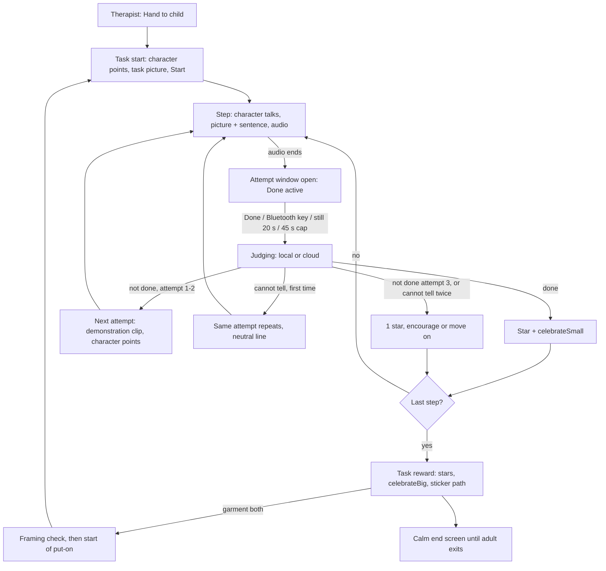

# Child flow (end to end)

Status as of 2026-11-14. Tags: **[BUILT]** = in the code now; **[PLANNED]** = in the PRD, epics or design but not built yet; **[PENDING ASSETS]** = the code is built but real art, audio or clips are missing. The code (`ui/child/*`, `session/AssessmentRunner.kt`, `training/TrainingRunner.kt`, `rewards/*`, `scoring/RulesEngine.kt`, `vision/VerifierRouter.kt`) is the source of truth.

## Overview

The child only ever sees child mode, and only after the therapist hands over the tablet. The screen is pinned. A start screen shows the task picture and one big Start button. Then each step follows the same pattern: the side character says the step (audio), the Done button unlocks when the audio ends, the child tries, and the child taps Done (or presses a Bluetooth button). The camera judges the attempt on the tablet, or asks the cloud for object steps. If the step was not done, the next attempt shows the character's demonstration clip. A done step earns a star and a small celebration. Doubt is never failure: an unclear attempt repeats once with a neutral line, then the step is "not scored" and the task moves on. After the last step a reward screen shows the stars and progress toward a sticker. The child never sees levels, errors or network problems. The adult leaves child mode through a hidden corner and the PIN.

---

## 1. Task start screen [BUILT]

What happens:
- The side character (the child's boy or girl) points toward the task picture (the first step's still), with the task name and one big Start ("يلا نبدأ").
- Only Start can be pressed. A Bluetooth key press also counts as Start.
- Shown for a new session, or for a continued session that has no saved attempt yet.

Edge cases:
- [PENDING ASSETS] Task-name audio is not generated (ElevenLabs blocked); the name is text only.
- No task name in the catalogue: no text (never the raw task ID).
- Missing still: the screen shows without a picture.
- Adult corner (top band, 2 s hold) works here; Pause just dims and holds the screen.
- Continued session with saved attempts: no start screen; it resumes at the saved step.

## 2. Step screen layout [BUILT]

The layout is the same on every step (predictability):
- Top band: star bar, step schedule (one dot per step, never shows outcome), adult corner.
- Side zone: the side character, always visible and animated (decided 2026-11-14).
- Main zone: step picture and sentence at prompt level 1; demonstration clip from level 2.
- Bottom band: **Done** (at least 220 x 160 dp), **Help**, **Repeat**.
- The camera preview is never shown to the child during steps.

## 3. Instruction (prompt) [BUILT, PENDING ASSETS for audio]

What happens:
- The step sentence plays as audio (normal speed; slow at level 3). The character is in `talk`.
- Done is dimmed (not hidden) while the audio plays. The attempt window opens only when the audio ends.

Edge cases:
- [PENDING ASSETS] No instruction audio exists yet. When audio is missing, the sentence shows and the window opens after a fixed 1.5 s (`MISSING_AUDIO_DELAY_MS`).
- Screen covered (PIN on top) or app stopped: audio stops; on return the current prompt restarts with a fresh window. Screen off or app backgrounded: back within 60 s, the same screen returns without the PIN; after 60 s the PIN is asked and the session is saved `paused` (owner decision 2026-11-14).
- A step-end effect from the previous step finishes first; the next audio waits (effects never overlap instruction audio).

## 4. Side character states [BUILT, PENDING ASSETS for girl]

| Moment | Character state |
|---|---|
| Start screen | `point` toward the task picture |
| Instruction audio | `talk` (any level) |
| Child is trying | `idle` |
| Level rises to 2 or 3 (not done, or Help) | `point` toward the demonstration for 2 s, then `idle` |
| Step done | `celebrateSmall` |
| Not done after attempt 3 | `encourage` |
| Task reward | `celebrateBig` |
| Paused | `idle`, still |

Edge cases:
- A missing state clip falls back to `idle`, then to the first clip available.
- [PENDING ASSETS] Boy has 7 reaction clips and 81 step clips; the girl has 7 reaction clips and no step clips yet. Clips are animated WebP.
- Talk wins over point if audio starts during the point.

## 5. Attempt window [BUILT]

What happens:
- Opens when the instruction ends. Closes on the first of:
  - Done tapped anywhere in the Done area, or any Bluetooth/hardware key (except volume and power);
  - after 20 s, when the child has not moved for 2 s;
  - a hard cap of 45 s.
- Camera-scored steps run the front camera in the background (no preview); frames are kept only for this window.

Edge cases:
- Double tap on Done: debounced (1 s); only one close counts.
- Done while the window is not open (audio playing): ignored.
- Window closed by stillness and the check is not met: saved as **cannot tell** (`not_judgeable`), never "not done".
- Camera fails to start: no frames arrive; camera steps end as cannot tell `out_of_frame`. Only the adult sees a notice, in the pause sheet.
- Back button: does nothing on the step screen.
- Rotation: landscape only; flipping sides keeps the run (ViewModel survives).

## 6. Help and Repeat [BUILT]

- **Help**: moves to the next prompt level at once (max 3) and counts as a prompt. At level 3 it replays level 3.
- **Repeat**: replays the current level's audio and character talk; changes nothing.

## 7. Demonstration from attempt 2 [BUILT, PENDING ASSETS]

What happens:
- Level 1: still picture + sentence + audio.
- Level 2 (second attempt, or Help): the step's demonstration clip (the character performs the step) in the main area, with audio. The side character points at it.
- Level 3 (third attempt): the demonstration clip large, slow audio. Buttons stay in the bottom band.
- There is no end-of-task walkthrough (removed 2026-11-13).

Edge cases:
- [PENDING ASSETS] A step with no clip (all girl steps, many boy steps): the still picture is shown enlarged instead.
- Transitions are cross-fades/slides, no hard cuts.

## 8. Judging [BUILT]

What happens:
- `VerifierRouter` picks the verifier by the step's method: `none` (content-only), pose, hand, or cloud.
- Before any check, a visibility gate: more than half of the window's frames must show the needed body points, else cannot tell `out_of_frame`.
- Local verdicts take under about 300 ms; cloud verdicts up to 8 s. The child sees the character idle with soft dots, no text, no spinner.
- Only cropped frames without identifiers go to the proxy.

Edge cases (all become **cannot tell**, never "not done"):

| Situation | Reason saved |
|---|---|
| Body out of frame | `out_of_frame` |
| Zone needed but not drawn | `no_zone` |
| Proxy not set up, no network | `network` |
| Cloud call over 8 s, or verifier hangs over 10 s | `timeout` |
| Proxy answers non-200 (for example 401 wrong secret) | `refused` |
| Model answer cannot be parsed | `bad_answer` |
| Verifier throws | `verifier_error` |
| Clip cannot be decoded (replay) | `not_judgeable` |

- Network lost: the child sees nothing different. The therapist sees a banner afterwards.
- `none` steps (content-only tasks): no camera judging; the steps end "not scored".
- A failed database save is retried every 2 s without telling the child.

## 9. Step outcome (Rule 1) [BUILT]

| Result | What the child sees | Saved level |
|---|---|---|
| Done on attempt 1 at level 1 | Star + celebration | 3 |
| Done on attempt 2 or 3 | Star + celebration | 2 |
| Not done on attempt 1 or 2 | Next attempt starts at the next prompt level; no other feedback | (attempt logged) |
| Not done on attempt 3 | `encourage` + calm line ("هنجربها سوا المرة الجاية"), next step | 1 |
| Cannot tell, first time | The same attempt repeats once at the same prompt level, neutral line | (reason logged) |
| Cannot tell, second time | Moves on calmly | not scored |

## 10. Stars and step effects [BUILT, PENDING ASSETS for sounds]

What happens:
- Stars: done on the first try = 2; done later = 1; finished without done (not done after attempt 3, not scored, content-only) = 1. Stars only increase.
- Effects start only after the verdict and stars are saved and never during instruction audio. At most 3 flashes per second.

| Effect level | Step done | Not done after attempt 3 |
|---|---|---|
| full | Star flies from the character to the star bar with twinkles, Konfetti burst, chime, `celebrateSmall` | `encourage` + calm line, no sound |
| calm (default) | Star fades in on the character, glides slowly to the bar, soft sound, `celebrateSmall` | same |

Edge cases:
- System "remove animations" on: calm behaviour; the star does not travel.
- [PENDING ASSETS] Chime and soft sounds are not generated: a missing sound plays nothing.
- Adult pause or screen gone during an effect: the effect is cut and never replayed later.
- Star rewards are idempotent per (session, step): retries or a restore never double-count.
- The eval child and replay sessions earn nothing.

## 11. Task end and reward screen [BUILT, PENDING ASSETS for stickers]

What happens:
- After the last step, the session is saved `done`, then the task reward screen replaces the step screen: the task's stars, `celebrateBig`, and a 3-slot sticker path. Full: one gentle Konfetti burst; calm: the clip fading in slowly.
- One sticker unlocks every 3 finished tasks (3/6/9 -> 1/2/3). A finished training run also counts as a task.
- Big "Next" button, "My stickers" button, and auto-continue after 10 s (paused while the sticker book or adult sheet is open).
- Then the calm end screen until the adult exits, or the jacket chain continues.

Edge cases:
- Sticker unlock is written once in a transaction: retries, restores or double calls never duplicate a sticker.
- Eval child, or reward data cannot load: no reward screen; it continues at once (never blocks).
- The adult corner works here.
- No end-of-task walkthrough (removed).

## 12. Sticker book [BUILT, PENDING ASSETS]

- Opened from the reward screen ("My stickers") or from the child's Overview by the therapist.
- 30 slots: earned stickers in colour, locked ones as soft outlines, plus the 3-slot path to the next sticker.
- [PENDING ASSETS] No sticker art yet (Story 2.6 deferred): placeholder badges drawn by index. Real art can replace them without code changes.
- Load failure: a calm empty book, never an error.

## 13. Garment chain ("both") [BUILT]

- Take-off runs first (owners' order). After the take-off reward screen, put-on replaces it in place as a new session. Screen pinning stays on.
- The framing check shows inside child mode first (skipped if content-only), then the start screen.
- The chain is saved on the session, so Continue keeps it.

## 14. Adult pause sheet and exit [BUILT]

What happens:
- Hold the small corner in the top band for 2 s: the pause sheet opens (Pause / Resume / Exit).
- Pause: the open window is dropped (no attempt row), the session is saved `paused`, the screen dims, the character sits still.
- Resume: the current attempt restarts from its beginning at the same prompt level.
- Exit: the session is saved `paused` (still resumable), then the PIN screen. Right PIN leaves child mode.

Edge cases:
- Pause while judging is ignored (it could drop or duplicate a row).
- Camera unavailable: the sheet tells the adult that camera steps are being saved as cannot tell.
- App killed in child mode: the session stays `running`/`paused`; the therapist gets a Continue card. On continue, the interrupted attempt restarts from the instruction at the saved step, attempt and prompt level; earlier rows are kept.

## 15. Training screens [BUILT, PENDING ASSETS]

What happens:
- Activities run one at a time in the picked order, in the same layout as steps (side character, top band, Done in the bottom band).
- **Camera-counted** activity: big count and target ("٣ من ١٠") inside a sage ring; left and right counted separately for per-side activities. Completes at the criterion. Background camera, no preview.
- **Guided** activity: illustration, instruction, a timer that counts up (never down), Done.
- Each finished activity saves one result row; stars: criterion met by the camera = 2, otherwise 1.
- At the end: the task reward screen, then a calm end screen (soft heart, one sentence) with a hand-back button that opens the PIN.

Edge cases:
- [PENDING ASSETS] No instruction audio: Done unlocks after 1.5 s.
- Counter: hysteresis (high then low), repetitions under 0.4 s ignored, noise between thresholds not counted; a hold accumulates while true and resets on a break.
- Pause freezes the timer and ignores frames. A criterion reached while the sheet was open is checked again on resume.
- Exit mid-activity: nothing is saved for that activity.
- Save fails: the activity stays on screen; Done retries the same row ID (no duplicates); stars are re-recorded idempotently.
- Process death: result IDs are `runId:index`, and the runner skips activities that already have a row. But the run key lives only in memory, so after process death the PIN is shown and the run is not resumed. Decided 2026-11-14: this stays as is (no resume for an interrupted training run); finished activities keep their rows.
- Catalogue fails or no picked activity exists: a calm message and the adult way out.

---

## Open questions / things to verify on the phone

1. **Screen off during a step.** Decided 2026-11-14: within 60 s the same child screen returns (attempt restarts); after 60 s the PIN shows and the session is `paused` with a Continue card. Verify both on the phone.
2. Bluetooth clicker as Done at 1.8 m (jacket), and as Start on the start screen.
3. Timing of the 1.5 s missing-audio fallback feels right until real audio exists.
4. Girl character: step clips missing, so levels 2-3 show the enlarged still only.
5. `drink.cup.02` once logged two rows with attempt 1 on the cannot-tell repeat (bug noted in 3.5; check it is fixed).
6. Training Done band layout (flagged in the side-character review).
7. Calm vs full effects at a distance; star readable at 1.8 m.
8. Is 1 star for a "not scored" step (two cannot tells) the wanted rule? The docs were silent; the code gives 1 star.
9. Should a training run count toward sticker unlocks? The code counts it; Epic 4 context says "finished assessment tasks".
10. Training after process death cannot be resumed: accepted as is (owner decision 2026-11-14).
