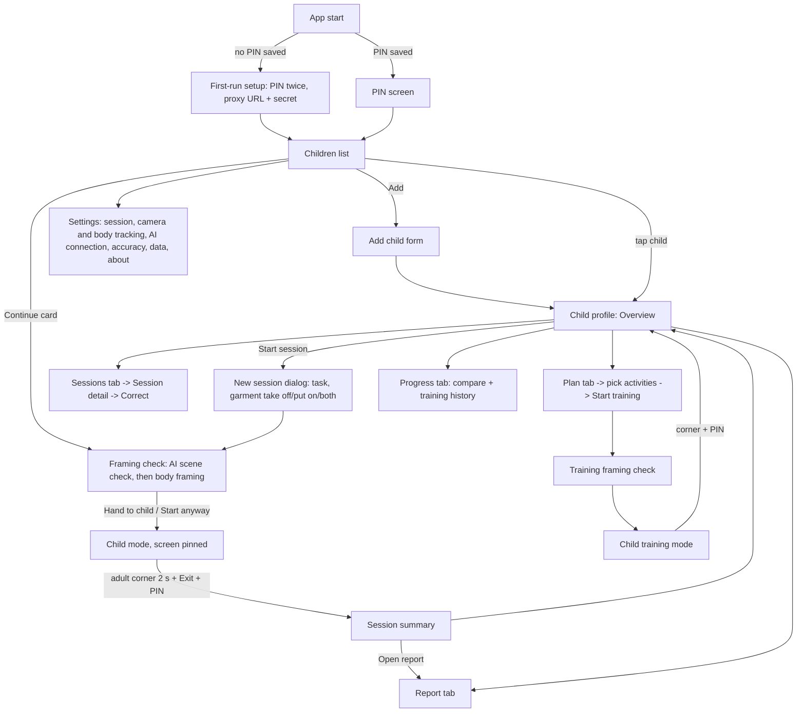

# Therapist flow (end to end)

Status as of 2026-11-14. Tags: **[BUILT]** = in the code now; **[PLANNED]** = in the PRD, epics or design but not built yet; **[PENDING ASSETS]** = the code is built but real art, audio or clips are missing. The code in `android/app/src/main/java/com/aitherapist/dls/` is the source of truth for current behaviour. When this document and the planning docs disagree, the code wins and the difference is listed at the end.

## Overview

The occupational therapist runs everything on one landscape tablet. On first launch the therapist sets a PIN and the cloud-check (proxy) address and secret. Every later launch starts at the PIN screen. The home screen is the children list. The therapist adds a child, opens the child's profile, and starts a session: picks a task (a garment can be "take off", "put on" or "both", default both), lets the AI check the scene (it finds the table, sink and other zones itself), checks the camera framing, and hands the tablet to the child. Child mode is locked with screen pinning. To leave it, the adult holds a hidden corner for 2 seconds and enters the PIN. The therapist then sees a summary of that visit, and can read the report, open the treatment plan, start training, check each session's evidence and correct levels, compare assessments, and use Settings (session and PIN, camera and body tracking, AI connection, accuracy and review, data export, about). All child data stays on the tablet.

---

## 1. First-run setup [BUILT]

What happens:
- Shown when no PIN is saved (`AppGateViewModel` puts `SetupKey` on the stack).
- Steps: welcome, PIN entered twice (4 to 6 digits), proxy URL (must be an absolute `https` URL with a host) and shared secret (masked, never shown again).
- Everything is saved at once. The PIN is saved last; once it exists, setup counts as complete.
- Saving the connection and PIN ends setup and opens the children list. There is no zone step: zones come from the AI scene check before each session (Story 6.4, 2026-11-15).
- Debug builds prefill proxy values from `local.properties`; release builds start empty.

Edge cases:
- PIN entries do not match, or wrong length: the form refuses and stays on the step.
- Bad proxy URL (http, no host): refused inline.
- Save fails: error shown, typed values kept, can retry.
- App killed during setup before the PIN is saved: setup starts again on next launch.
- Backgrounded during setup: setup is kept (the background lock only applies to the therapist shell).
- Proxy left wrong: setup still finishes; cloud-judged steps will end as "cannot tell" until it is fixed in Settings. Diagnostics shows "wrong secret" for a 401.
- Keystore key or settings file lost: the database cannot open. [PLANNED] a guarded "reset all data" path (deferred, not built).
- Settings read fails at start: an error screen with Retry (`GateState.Error`).

## 2. PIN screen [BUILT]

What happens:
- Shown on every app start after setup, after the app goes to the background, and when leaving child mode.
- Right PIN opens the therapist shell; the PIN screen is replaced so Back cannot return to it.

Edge cases:
- Wrong PIN: the field clears, no hint. After 5 wrong PINs in a row the pad is disabled for 30 s with a calm countdown ("Please wait N seconds", neutral colour). A right PIN resets the counter. The counter and the lockout end time are saved in DataStore (`SecureSettings`), so killing the app does not skip the wait; a clock set back never stretches it past 30 s (owner decision 2026-11-14).
- App goes to background from any therapist screen: the whole stack is cleared and the PIN is asked again (FR-2). After unlocking, the therapist lands on the Children list, not the previous profile tab (known gap, deferred).
- Opening system Settings for the camera permission does not trigger the lock (an "external return" is expected once).
- Process death: the back stack is not saved, so the PIN is always asked again.
- Back on the PIN screen at the root: the app moves to the background (it does not close).

## 3. Children list (home) [BUILT]

What happens:
- Rail on the start side (right in RTL) with two entries only: **Children** and **Settings**.
- List of children ordered by name, with avatar (the child's character still), name and age (Western digits). Search by name. "Add child" action.
- "Continue" card for each child with an interrupted session (one card per child, newest session). It shows the child name and task name only, never levels.
- A calm network banner appears at the top when the tablet is offline, or for 8 s after a failed cloud check. It is never shown in child mode.

Edge cases:
- No children: empty state with "Add child".
- The hidden eval child (used for replay and evaluation) never appears in the list and never gets a Continue card.
- Session query fails: only the Continue cards hide; the children still show.
- Catalogue fails to load: Continue cards show raw task IDs instead of names.
- Loading: skeleton with shimmer after 150 ms, never a full-screen spinner.

## 4. Add child / edit child [BUILT]

What happens:
- Form: name (max 40 chars), age (whole years 1 to 18), character (boy or girl), effect level (**calm** default, or **full**), "Show time ring" switch (on by default; off hides the child's per-step time ring, the step time still applies; Story 6.2).
- The child code is generated automatically and hidden; the therapist never types it.
- After save, the profile opens on Overview.
- Edit mode from the profile; Delete with confirmation. Delete removes the child and all sessions, attempts, corrections, rewards, training results and evidence frames (cascade).

Edge cases:
- Empty name, age not a number ("x"), out of range: refused with a field message.
- Save fails: typed form is kept with a message.
- Effect level "off" was removed (2026-11-12); only full and calm exist.
- No in-app consent screen (FR-43 removed; consent is verbal, outside the app).
- Rotation: landscape only (`sensorLandscape`), so it flips between the two landscape sides; form state is kept.

## 5. Child profile tabs [BUILT]

Tabs (agreed IA 2026-11-13): **Overview**, **Sessions**, **Report**, **Plan**, **Progress**.

| Tab | Contents | Notes |
|---|---|---|
| Overview | Avatar, name, age, character, effect level, "Start session"; sticker cabinet (stickers earned, sticker book entry); quick stats (last assessment, tasks finished — two equal tiles) | Sticker book opens as a full dialog. In portrait the top bar names the child and holds **Edit**; no second "Child profile" heading |
| Sessions | Assessments and training runs, newest first; an assessment opens Session detail | Read-only list |
| Report | Domain averages, plan levels, strengths and needs | Recomputed on every open |
| Plan | Activities per weak domain, picker, "Start training (n)" | Draft selection saved per child |
| Progress | Compare two assessments; training history | Recomputed on every open |

Edge cases:
- A tab with no data shows a calm empty state with a primary action (for example "Start session").
- Every tab reloads when opened; nothing derived (levels, averages, plans) is stored.
- Errors show inline with Retry; the reason is only the exception type, never child data.

## 6. New session, garment choice, continue [BUILT]

What happens:
- "Start session" opens the New session dialog: task tiles grouped by area. Each tile shows the first step's still for the child's character.
- **Task readiness (2026-11-15):** a task is ready for the child's character when every step has its demonstration clip in the APK (paths from the catalogue's step media; the asset folders are listed once and cached). Ready tasks work as before. Not-ready tasks are greyed with a "Coming soon" badge and cannot be selected. Areas with no ready task still show so the owner sees what is coming; ready tasks come first inside an area and areas with a ready task come first. For a garment pair, a half without clips is disabled in take off / put on / both, and selection defaults to the ready half. No debug override.
- Every garment with `.on` and `.off` tasks in the catalogue (jacket, T-shirt, shirt, trousers, socks, shoes) is one tile with **take off**, **put on** or **both** (in that order; a pair defaults to **both**). "Both" runs take-off first, then put-on as a second session, inside the same child-mode visit (owners' order, `docs/reference/owner-posture-and-order.md`). The take-off steps for T-shirt, shirt, trousers, socks and shoes come from the team draft `docs/reference/undressing-steps-team-draft.md`, pending owner review.
- Start opens the framing check. It shows one positioning line from the task's catalogue posture: the child sits on a chair at the table (socks, shoes, eating, drinking), stands (jacket, T-shirt, shirt, handwashing, teeth), or stands and may sit if needed (trousers). Posture is staging only and never changes scoring. Content-only tasks (no camera check) skip the framing check, so they show no line.
- Continue card (children list) opens the framing check for the saved session, which then resumes it.

Edge cases:
- Double tap on Start: only one run opens (`openChildMode` / `openFramingCheck` ignore a second push).
- Starting a new session for a child abandons any older running or paused session of that child (at most one open session per child).
- Missing tile picture: the character's idle still is shown instead.
- Continue of a session whose task, catalogue version or resume point no longer fits: the session is marked abandoned, the child sees a calm end, and the card disappears.
- Continue of a session interrupted before any attempt was saved: it starts again at the task start screen.
- Garment "both" chain: the second task is saved on the session (`nextTaskId`, Story 4.1), so Continue keeps the chain. A chained task already finished after the session started is not run again.
- Training is not started here; it is started from the Plan tab (stage 10).

## 7. Framing check [BUILT]

What happens:
- **Phase 1, AI scene check (Story 6.4, 2026-11-15; for every task that uses zones or lists scene objects).** The app takes one camera photo. The child may already be in place: before sending, the eye band is pixelated on the tablet (from the forehead to just below the eyes, ear to ear, from the pose face points; without them, the top 15% of the body box). The mouth stays visible so eating and drinking can still be judged. The photo and the task's required kinds (the zone kinds its steps use, plus the task's scene objects from the catalogue `sceneObjects`, built from `tools/catalog-builder/task_scene.json`, e.g. table, chair, bowl and spoon for eating with a spoon; plus `person`) go to the proxy `POST /scene`. The found boxes are drawn and labelled over the preview. One clear message per problem names the missing thing ("مش لاقي الترابيزة — حطّ الترابيزة قدام الكاميرا", too dark, tilted, too far/close, unclear); "افحص تاني" checks again. When every required kind is found, the zone boxes (and the child's box) are saved as this session's zones (replacing the old ones) and phase 2 starts. Scene-object boxes are only shown and required, never saved or scored. Person-related issues never block.
- Offline or proxy error: a calm message plus "افحص تاني" and "ابدأ على أي حال". Start anyway clears the saved zones, so zone steps end as cannot tell `no_zone` (doubt is never failure). The same quiet Start anyway shows next to the issues.
- **Phase 2, body framing.** Large mirrored camera preview with a body outline for the task's framing (table, standing or sink).
- The outline is grey and turns sage once the task's needed body points stay visible for about 1 s.
- A guidance pill gives one line of advice (step back, move closer, move left/right).
- "Hand to child" starts child mode and screen pinning. A quiet "Start anyway" appears after 10 s without sage, or if the camera engine failed.
- Nothing here is scored. Only the face-blurred scene photo is sent (phase 1); the found zones are stored for scoring and to aim the cloud crops.

Edge cases:
- Content-only task (every step `none`): no framing check; hands over at once.
- Camera permission not yet asked: the system prompt shows. Denied: a message with "Allow" (asks again) and "Open settings". Going to system Settings does not trigger the PIN lock. (Deferred: a rationale screen before sending to settings.)
- Landmarks out of frame: outline stays grey; advice pill helps; "Start anyway" after 10 s. Steps then often end as cannot tell `out_of_frame`.
- Missing zone after Start anyway: an advisory notice names the zones the task checks; starting is allowed and those checks end as cannot tell `no_zone`. There is no manual zone editor any more.
- Catalogue cannot load: message plus "Start anyway".
- Back: returns to the profile; camera and landmarkers are released.
- Landmark stream gap over 300 ms resets the 1 s hold.

## 8. Hand to child [BUILT]

What happens:
- "Hand to child" first asks for screen pinning (lock task) while the framing check is still on screen; once pinning holds, child mode replaces the framing check. See `child-flow.md` for everything the child sees.
- While on the child step screen, any key except volume and power counts as Done (Bluetooth clicker), and Back does nothing.

Edge cases:
- First hand-off on the tablet only: a short adult dialog explains screen pinning (keeps the child in the app), that Android shows its own "App is pinned" message, and how to finish (hold the adult corner, enter the PIN). "Start" goes on; it never shows again (a UI flag on the tablet, no child data). Settings > Session & child mode repeats the explanation.
- Screen pinning is not device-owner allow-listed: Android shows its own pinning message and it can be declined. If pinning is refused or fails (not active within about 6 s), child mode **starts anyway**, unpinned for this visit (no new prompt, no blocking notice). After the visit, back on the therapist screen, a small dismissable hint says the last session ran without pinning. The child never sees it (owner decision 2026-11-15, replaces the 2026-11-14 notice with retry). Device-owner setup is still deferred. Same for the training hand-off.
- Garment "both": after the first task's reward screen, the second task shows its framing check inside child mode (pinning stays on), then its start screen.

## 9. Return via PIN and session summary [BUILT]

What happens:
- Adult holds the corner 2 s, the pause sheet opens, Exit saves the session `paused`, then the PIN screen opens above child mode.
- Right PIN leaves child mode (pinning stops) and shows the **session summary** of exactly this visit's sessions (two sections for a garment chain): each step and its level, with counts per level.
- Close goes to the child's Overview; "Open report" goes to the Report tab.

Edge cases:
- Visit left before any session existed (for example on the start screen of a new run): no summary, straight to Overview.
- The summary shows only sessions saved `done`. An exited, unfinished session is `paused` and shows a Continue card instead.
- The summary is read-only. Corrections are made in Session detail (stage 13) and show here next time it loads.
- Wrong PIN in child mode: field clears; the child screen stays paused below. The 5-try lockout applies here too.
- App goes to background (or screen turns off) while in child mode (owner decision 2026-11-14): back within 60 s, the same child screen returns without the PIN and the current attempt restarts (as Resume). After more than 60 s, the PIN is asked, the stack is cleared, the session is saved `paused` and offered as a Continue card (no summary). Therapist mode still locks at once.

## 10. Report [BUILT]

What happens:
- Built from the latest finished (`done`) assessment of each task. Recomputed on every open by the pure `RulesEngine`.
- Domain bar chart (Vico) with plan-level colour plus number and word, a domain table (average to one decimal, plan word, scored-step count), strengths (level-3 steps) and needs (level-2/1 steps) worded "may be related to" their domains.
- Rule 2: average 3 = strength (no plan), 2.5 to under 3 = mild, 1.5 to under 2.5 = moderate, under 1.5 = severe.

Edge cases:
- No finished assessment: empty state with "Start session".
- A domain with no scored steps: "No scored steps", never 0.0.
- "Visual-motor coordination" counts as Motor coordination; a step with both tags counts once.
- Not scored steps (cannot tell twice, content-only steps) are excluded from averages.
- 8 steps have no domain tag in the source: they count as strengths/needs but feed no domain.
- Corrections apply immediately (latest correction wins).
- Replay sessions, running, paused and abandoned sessions never count.
- Arabic domain and level labels were authored, not taken from `docs/reference/`: owner review pending.

## 11. Plan and activity picker [BUILT]

What happens:
- For each weak domain, all activities of the matching plan level and domain section, weakest domain first. Several plan levels can show at once. Nothing for a strength.
- Each activity expands to tools, how to perform, goal and criterion, verbatim from the catalogue.
- Checklist selection; sticky bar "Start training (n)".

Edge cases:
- No report yet, or all strengths: empty state.
- The draft selection is saved per child (IDs only): it survives rotation, the PIN lock and process death. It is cleared when training starts. IDs no longer in the plan are dropped.
- Reload fails with old content on screen: old content stays with a reload error.
- [PENDING ASSETS] Activity details are English in the catalogue (only titles have Arabic). They show left-aligned. Arabic translation is planned with the end-of-project audio run.

## 12. Training hand-off [BUILT]

What happens:
- "Start training" opens a framing check for the picked activities' camera counters. With no camera-counted activity it skips straight to the child.
- Then the child training run (see `child-flow.md`, stage 9). Exit via corner + PIN returns to the profile. No session summary for training.

Edge cases:
- Nothing picked: the button is disabled; `openTraining` also refuses an empty list or a second push.
- Results appear in Progress -> Training history and the Sessions tab.

## 13. Session detail and correction [BUILT]

What happens:
- Sessions tab -> an assessment row opens Session detail (full-screen dialog): every step with its level chip, every attempt with verdict, reason, verifier kind (pose / hand / cloud / none, with the model ID for cloud) and up to 3 evidence frames (start, middle, end).
- Tap a frame to enlarge. Frames are decrypted in memory only, never written out.
- **Correct** opens a sheet: 3 / 2 / 1 / not scored, showing the automatic level. Save upserts the correction. "Remove correction" (only when one exists) returns to the automatic level.
- Report, plan, summary and compare use the corrected level on their next load.

Edge cases:
- Missing or unreadable frame: calm placeholder.
- Saving the automatic level as a first correction, or saving nothing: no change.
- A not-scored step can be corrected to a level, and a scored one to "not scored" (stored as null).
- Corrections never change the saved attempt facts, and never change stars.
- Corrections are separate from blind ratings (stage 16): blind ratings never change levels.

## 14. Compare and progress [BUILT]

What happens:
- Progress tab: compare two finished assessments of the same task, per-domain averages and the difference, shown with a neutral colour and a word (never red).
- Training history: activity, count, duration, criterion met, newest first.

Edge cases:
- Fewer than two finished assessments of a task: nothing to compare (empty state).
- A domain with no average in one assessment: shown as no average, never 0.0.
- Catalogue unreadable: rows listed by activity ID.

## 15. Diagnostics [BUILT]

What happens:
- Settings -> Diagnostics (in release builds too). Shows frame rate, landmark group visibility, proxy reachability and latency, and the cannot-tell rate.
- Proxy ping and cannot-tell rate run on open and on "Check again" only, never polled.
- Developer metrics inside Diagnostics (frame rates, spike attempt, sample screen) are debug builds only. The zones card and its "draw zones" link were removed in Story 6.4.

Edge cases:
- Proxy health results: OK, wrong secret (HTTP 401), not configured, settings unreadable, offline, timeout, unexpected.
- Camera cannot start: shown as an error state with the exception type only.

## 16. Blind review [BUILT, story 5.7 uncommitted]

What happens:
- Settings -> Blind review (release too, behind the PIN). One attempt at a time, frames (and the replay clip when it exists) plus the step sentence only. Never the app verdict, level, child, session or file names.
- Answers: done / not done / cannot tell. Skip leaves it unrated; it returns at the end of the queue.
- Every attempt is rated, retries included. Order is a seeded shuffle; two attempts of the same step are not placed next to each other.

Edge cases:
- No attempt with frames: empty state. All rated: calm end state.
- Attempt deleted meanwhile (child or session removed): dropped, counts refresh.
- Ratings never feed levels, reports, plans or compare.

## 17. Replay and evaluation [INFRASTRUCTURE ONLY since Story 6.4]

What happens:
- The in-app entry (Settings -> Advanced tools -> Replay & evaluation) was removed with the developer tools in Story 6.4; the replay code in `replay/` and its tests stay for evaluation. It imports volunteer clips, scores them through the same runner as live sessions and exports a CSV for `tools/eval/accuracy_report.py`.
- Replay sessions belong to the hidden eval child.

Edge cases:
- A clip that cannot be decoded: cannot tell `not_judgeable`.
- Zone steps in clips filmed elsewhere: cannot tell `no_zone` (shown with a hint).
- Replay never feeds reports, plans, compare or rewards, and never shows in the children list.
- CSV holds no child data and never the model's free-text reason.
- [PLANNED] Accuracy metrics script and dashboard (5.8), evaluation run and Goal 8 report (5.9). [PENDING ASSETS] volunteer clips.

## 18. Settings [BUILT]

Sections, in this order (2026-11-15). Landscape: section list on the start side, the chosen section beside it. Portrait: the section list, and a section opens as its own page with the detail top bar (back) and the calm slide.

1. **Session & child mode:** change PIN (current + new twice; it is also the child-mode exit PIN); screen pinning explanation. Effect level is per child (child profile), so there is no default here.
2. **Camera & body tracking:** Diagnostics (camera check, landmarks, speed, proxy). Zones are not edited here any more: the AI scene check finds them before each session.
3. **AI connection:** status line (not set up / ready / offline / last check failed); **Test connection** runs the Diagnostics health ping (`POST /verify` with the secret and an empty body: no frames, no child data, nothing logged) and shows "Connected" or "Not reachable right now" with what to try and a calm note that sessions still run with "cannot tell" for review; proxy URL and secret (never shown).
4. **Accuracy & review:** Accuracy metrics, Blind review.
5. **Data:** Export results (anonymised CSV).
6. **About.**

Removed in Story 6.4 (2026-11-15): the manual zone editor and the Developer tools section (Replay & evaluation, Try step screen, Character preview).

Built instead (Story 6.4): the AI scene check finds the zones before every session; see section 7.

Edge cases:
- Wrong current PIN: refused. New PINs that do not match: refused.
- Settings unreadable: values show as blank; cloud checks then end as cannot tell; Test connection says the settings could not be read.
- Back from a sub-page returns to the same section; in portrait Back from a section returns to the section list.

---

## Open questions / things to verify on the phone

1. **Screen off or background during child mode.** Decided 2026-11-14: 60 s grace (see stage 9). Check on the phone: short screen-off returns to the child screen; long one shows the PIN and a Continue card.
2. Landing on the Children list after a PIN lock instead of the last profile tab (known gap).
3. Screen pinning can be declined; child mode then starts unpinned and the adult sees a small hint afterwards (2026-11-15). Confirm on the tablet and decide on device-owner setup.
4. Proxy with a wrong secret: during a session every cloud step becomes cannot tell `refused` (any non-200). Confirm Diagnostics clearly says "wrong secret" and the banner shows.
5. Evidence frames load fast enough in Session detail with many attempts.
6. Delete child really removes evidence frame folders (orphan sweep is deferred).
7. Blind review (5.7) is uncommitted: run it on the phone with real attempts.
8. Report and plan labels in Arabic need owner review; activity details still English.
9. PIN lockout decided 2026-11-14: 5 wrong tries, then 30 s (see stage 2).
10. Training has no post-PIN summary; confirm that is wanted.
